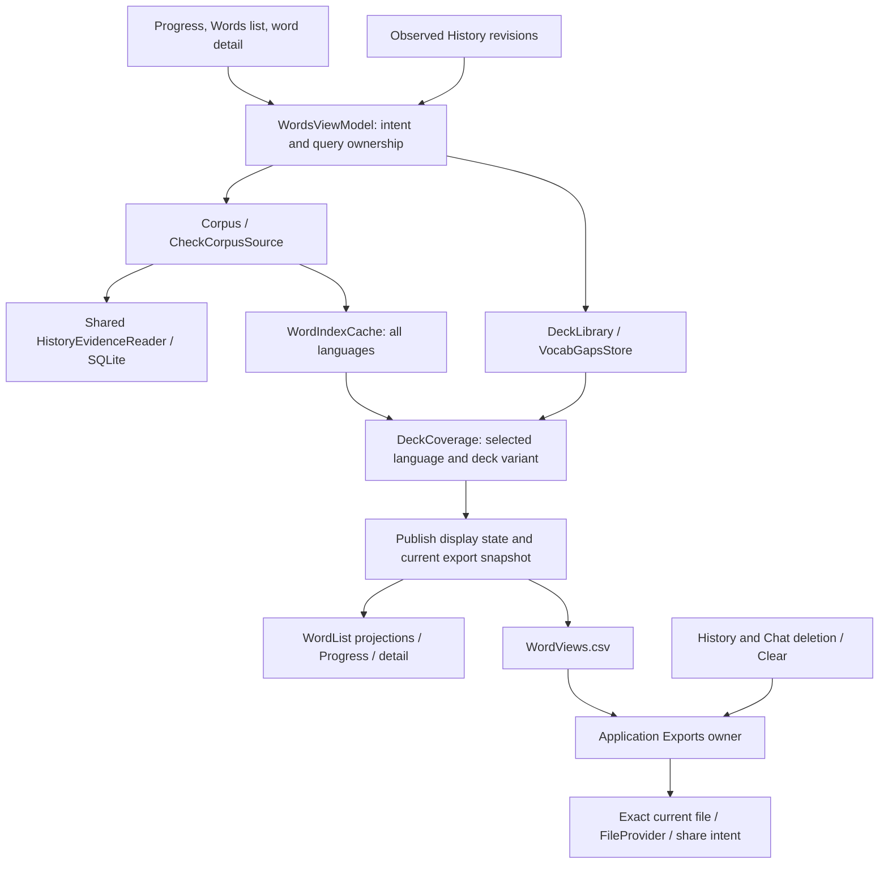

# Words query-to-export review

Step 1, reviewed against `ff213856d667c0e451e2801132c85267261ca5f4`.
The comparison is `5b5ecd9`, which includes the other agent's feature work before
the audit changes were integrated. `WordsViewModel.kt` grew from 355 to 643 lines
(+288). The cumulative production Kotlin increase remains +2,119 lines.
This document changes no app behavior or tests.

The review covers the complete path, including unchanged code: route entry,
Progress/list/detail consumers, evidence reads, indexing, deck inventory and
selection, coverage, import/deletion interactions, CSV creation, export retirement,
and the Android share handoff. Four parallel reviews examined UI/navigation,
core/read behavior, storage/export boundaries, and state/test contracts.

## Assessment

There is concrete repeated work and a plausible redundant lock. The larger
architectural problem is that `loadQuery` combines restoration, reads, calculation,
failure reconciliation, publication, and persistence. Several fields must agree
for one result to be publishable and exportable.

However, the screen result, cached coverage, and export snapshot are not three
copies of a payload that can simply be deleted. They contain shared references
and serve different lifetimes. The first proposed cleanup should target the
specific overlaps below, without introducing another general coordinator.

## Complete path

- `HomeActivity.kt:68,174` owns one Words model shared by Progress, the list,
  and details. Progress reads the all-language index and requests refresh;
  list entry applies an explicit language; detail entry pins its nullable
  language and level. An Auto list preserves local selection. Explicit route
  choices must win over delayed remembered-selection reads.
- `WordsViewModel.kt:187–229` invalidates old queries and exports immediately,
  then optionally delays work for 250 ms. Search, sort, and list filter are
  presentation changes and do not rebuild evidence (`409–411`).
- `App.kt` supplies a shared History reader and a Corpus containing
  `CheckCorpusSource`. The source requests the newest 3,000 visible checks
  before language and writer-evidence exclusions. A successful bounded read,
  partial/failed read, and successful empty read have different meanings.
- `WordIndexCache` reuses the all-language analysis by content fingerprint and
  month. `DeckLibrary` caches parsed decks by ID and lemmatizer instance;
  `App` shares bundled decks. Coverage is a separate calculation against the
  selected language and deck variant, with its own one-entry cache.
- `loadQuery` restores selection, resolves inventory and deck, computes coverage,
  publishes the result, then saves selection (`232–361`). Failed reads can retain
  prior display data while making export unavailable. Committed deck membership
  can change even when later file cleanup fails.
- `exportCsv` captures the complete selected-language result, checks source
  retirement, requests a shared export ticket, and writes through `Exports`
  (`421–465`). Local action identity, query identity, shared ownership, and the
  exact resulting file are checked before publication. The final handoff checks
  the still-current event and exact file; query/action invalidation clears that
  event. Handling the event leaves the granted file available to its receiver.

## Findings and attribution

| Finding | Evidence at the reviewed commit | Attribution and status |
|---|---|---|
| The coverage cache distinguishes inputs that produce the same calculation. | `WordsViewModel.kt:161,316–320` keys by full `WordLevel`; Forms and Lexemes use the same deck variant. Decks without lexemes use `byLemma()` at every effective level. A changed key repeats matching, phrase scans, and summaries in `DeckCoverage.kt:74–119`. | Confirmed by source tracing. Full-level identity was introduced in audit commit `1a9d7cc`; baseline line 176 distinguished only `level == Lemmas`. Keep full UI/selection level while considering a coverage key based on the actual deck variant. |
| Selection writes have two serialization boundaries. | `WordsViewModel.kt:168,352` adds a mutex around `DeckLibrary.select`; `VocabGapsStore.kt:80–87,111–112` already holds a shared lock, checks the atomic current-query predicate, and writes synchronously. | Added during the audit. Static removal candidate: the store orders writes and rejects obsolete queued callers. Verify already-started old-write/new-selection ordering before removing the ViewModel mutex. The store lock and predicate must remain. |
| A normal query repeatedly reads the same imported-deck inventory. | `WordsViewModel.kt:291,297,299` calls `languages`, `decks`, and `imported`; each reads/decodes `index.json` through `DeckLibrary.kt:48–58` and `VocabGapsStore.kt:40–42`. An imported-deck cache miss can add a fourth membership read. | Predates the audit. Confirmed call-path duplication, without a latency measurement. Consider one query-local inventory value; preserve read failures and refresh after imports/deletions. These reads are not currently one transaction. |
| Measurement validity is maintained in several representations. | `WordsState` holds index/coverage and status flags; `lastCoverage` keeps a reusable result; `ReadyWords` binds one selected-language result to query and retirement identities. Request, failure, and success paths update different subsets (`210–343`). | Structural overlap worth simplifying, not proof that every representation is redundant. The all-language index, reusable coverage, and current export eligibility cannot be treated as interchangeable. |

The strongest first changes are therefore local: eliminate repeated coverage
work, test the extra selection mutex's necessity, and examine query-local
inventory reuse. A broad replacement of the ViewModel has not been justified.

`loadQuery` also calls `saveSelection` after every successful publication, whereas
the baseline returned before saving on a coverage cache hit. This is additional
dispatch/read work, not repeated disk writes: the store compares the existing
selection and skips an equal write. Do not remove that call indiscriminately;
selection-save retry must still persist the current choice.

Additional, lower-priority overlap appears outside the changed coordination code:
`WordsState` and `loadQuery` repeat language/empty-result/level resolution
(`112–123`, `294–296`, `316`); detail lookup constructs the whole combined row
list to find one row (`WordDetailScreen.kt:75–79`); Progress needs the all-language
index but instantiates the full deck/selection/coverage workflow. The latter two
predate the audit. A direct row lookup must preserve legacy-key precedence, and
decoupling Progress would require an explicit decision about selection side
effects. Neither warrants an additional feature framework as part of this step.

## State and ownership that must remain distinguishable

| State or identity | What it means | Why blanket consolidation is unsafe |
|---|---|---|
| `language`, `deckId`, `level`; explicit-choice flags | Current user/route intent and precedence over remembered selection. | Null language can be an explicit Auto choice, not an absent value. |
| `WordsState.index` and display projections | All-language evidence available to Progress and current screen projection. | A scope change immediately projects retained evidence into the new language while clearing incompatible coverage. Freezing the entire old display snapshot changes this behavior. |
| `lastCoverage` | Memoized calculation reusable when its content inputs match. | It may survive query invalidation; survival does not grant export permission. |
| `ReadyWords`, `exportReady`, `measuring` | Current successful measurement, button eligibility, and work status. | There is bookkeeping overlap, but failure retains display data without an exportable result. Global retirement also needs a fresh check at action time. |
| Query ID, job, `needsRebuild`, `indexGeneration` | Replaceable calculation ownership and evidence reuse. | Cancellation alone does not reject non-cooperative completion or a queued storage write. `indexGeneration` is an export-retirement generation, not the History revision or content fingerprint. |
| Local export action ID and shared `WordsRequest` sequence | Latest action in one model versus latest Words write across hosts. | Two exports can share one query; another Activity/model can supersede a file. |
| `Exports` retirement generation and exact current file | Source invalidation and which URI still represents a shareable file. | Clear/deletion can occur without a new History revision; an old callback must not delete a newer host's file. |
| Picker/import/scope IDs, deletion queue and mutex | Dialog ownership, accepted mutation completion, and precise cleanup retry IDs. | A new query must not cancel an accepted import or discard a failed deletion. These are not aliases for the query ID. |

Only references/metadata overlap is established here; no heap-saving claim follows
from combining objects. History revision/window identity, content-plus-month index
identity, deck morphology identity, and export retirement also serve different
cache validity rules.

Import/deletion jobs and their retry IDs remain ViewModel-lived, not a durable
queue across process death. Independent live models do not automatically refresh
each other's imported-deck inventory. The shared store lock prevents conflicting
file replacement; it does not define a global latest-selection policy across
different models. Preserve these boundaries rather than silently expanding them.

## Behavior and verification boundaries

The existing tests establish useful requirements for any later patch:

| Requirement | Existing evidence |
|---|---|
| Late language, deck, and level work cannot replace the latest result or selection. | `WordsQueryOwnershipTest.kt:66,86,107,123,143` |
| Explicit scope beats delayed restoration; Auto list entry preserves selection. | `WordsQueryOwnershipTest.kt:273,296,316,336`; `WordsNavigationTest` |
| Partial/failed evidence retains prior data, disables export, and allows retry; successful empty evidence really clears it. | `WordsEvidenceFailureTest.kt:57,80,116,135` |
| Accepted imports survive query replacement; cleanup failures retain exact IDs. | `WordsQueryOwnershipTest.kt:248,354`; `WordsEvidenceFailureTest.kt:146`; `WordsPersistenceTest` |
| Queued exports cannot use an old scope or retired evidence; the final handoff rechecks ownership. | `WordsQueryOwnershipTest.kt:160,183,205`; `WordsExportsTest`; `ExportsTest` |
| CSV remains all counted forms with their candidate lexemes, independent of screen search/filter/sort. | Source path: `WordsViewModel.kt:439–440`, `WordViews.kt:67–92`. CSV assertions: `WordIndexTest.kt:266,359`, `WordListTest.kt:158`, `WordAccuracyTest.kt:133`; scoped exports: `WordsQueryOwnershipTest.kt:160,183`. |

Preserve exact CSV header, ordering, rank metadata, counts, local dates, UTF-8,
CRLF, escaping, and formula protection. Lemma deck selection can change rank
metadata even though export ignores the screen's list filters. Do not change
the linguistic counting policy or evidence window during this cleanup.

There is no current coverage-build-count assertion for Forms-to-Lexemes reuse.
Existing index-cache build-count tests do not establish coverage-cache reuse.
Query-local inventory reuse likewise needs read-count and mutation/failure checks.
These are validation needs for later implementation, not new tests in this step.
Filter/search/sort independence is established from the source path; no focused
ViewModel test changes those controls while an export is queued. `WordsExportsTest`
tests file ownership with placeholder contents, not CSV counting or formatting.

One UI concern remains unverified: `WordDetailScreen.kt:75–85` can declare a deck
row gone while coverage is absent, without checking `measuring`. A route-level
change can clear coverage while retaining a loaded index (`WordsViewModel.kt:223`).
This source path warrants a delayed-render reproduction; current navigation tests
mainly inspect settled state. It is not presented as a confirmed runtime defect
or silently included in the cleanup scope.

This step performed source/history/test review and inspected the previous validated
commit's JUnit results; it did not run new app tests or benchmarks. Those results
contain 15 query-ownership, 4 persistence, 5 evidence-failure, 18 export, and
5 Words navigation tests, all passing without skips. They do not prove every
possible interleaving or the Android share sheet in another app.

Step 2 should turn the candidates into a mechanism-to-behavior comparison and
challenge the smallest proposed implementation. No line-saving target or rollback
is justified by this review alone.
